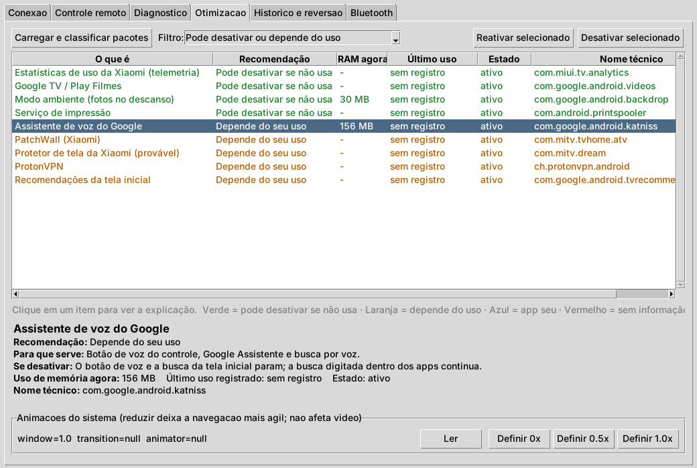

# Xiaomi TV Manager: controle e otimização do Mi TV Stick 4K pelo Windows

Programa para Windows que **controla, diagnostica e otimiza** o Xiaomi Mi TV Stick 4K (Android TV) pela rede Wi-Fi, usando o ADB (a ferramenta oficial do Android para computadores).

Ele foi feito para quem **não é técnico**. Em vez de nomes como `com.google.android.katniss`, você vê "Assistente de voz do Google", para que serve, o que acontece se desativar e uma recomendação clara. Toda alteração pede confirmação, fica registrada e pode ser desfeita com um clique.


<sub>Aba Otimização (imagem com dados de demonstração).</sub>

## O que ele faz

| Recurso | Descrição |
|---|---|
| **Conexão pela rede** | Encontra o Stick no Wi-Fi e conecta sozinho, com um assistente na primeira vez. Se algo falhar, o botão **Testar conexão** explica o motivo em português: depuração desligada, TV dormindo, PC e TV em redes diferentes ou "Depuração sem fio" com outra porta. Se a conexão cair, reconecta sozinho. |
| **Controle remoto no PC** | Direcional, OK, Voltar, Home, mídia, volume, ligar/dormir, digitar texto na TV, abrir apps. Funciona pelo mouse ou pelo teclado. Útil quando o controle Bluetooth falha. |
| **Espelhamento** | Mostra a tela da TV no PC com o [scrcpy](https://github.com/Genymobile/scrcpy), com controle por mouse e teclado. Conteúdo protegido (Netflix, Prime etc.) aparece preto no espelhamento: é a proteção DRM, não um defeito. |
| **Diagnóstico** | Memória, armazenamento, processador, apps que mais consomem, processos, erros recentes, rede e Bluetooth. Salva relatórios e **compara antes e depois** das otimizações. |
| **Otimização explicada** | Lista os apps com nome compreensível, recomendação em cores, memória usada agora e último uso. Desativa só com confirmação e reativa quando você quiser. Também reduz as animações do sistema. |
| **Histórico e reversão** | Cada alteração guarda o estado anterior e o comando para desfazer. Dá para reverter um item ou tudo de uma vez. |
| **Bluetooth** | Mostra se o controle está pareado e conectado e quantas desconexões houve, mais um checklist do que só se testa fisicamente (posição atrás da TV, pilhas, interferência de 2,4 GHz). |

## Segurança: o que o programa **nunca** faz

- Não usa root, não desbloqueia bootloader e não restaura padrões de fábrica.
- **Não desinstala** apps de fábrica e **não apaga dados**. Ele só *desativa* (`pm disable-user`), o que se desfaz com `pm enable`.
- **Bloqueia** a desativação do que é necessário: sistema, tela inicial, Google Play, Google Play Services, Chromecast, Bluetooth, Wi-Fi, componentes de vídeo/DRM, atualizações do sistema e apps de streaming (Netflix, YouTube, Prime Video, Disney+, Max, Globoplay, Spotify).
- **Trava de tela inicial:** nunca desativa o app que é a tela inicial padrão nem a única tela inicial instalada.
- Apps "sem informação" só são desativados se você digitar o nome técnico completo.
- Não altera o pareamento do controle remoto. Não mexe em antivírus, firewall nem políticas do Windows.

## Instalação

**Requisitos:** Windows 10 ou 11 com o *winget* (já vem no Windows atual) e o Mi TV Stick na **mesma rede** que o PC.

1. Clique em **Code → Download ZIP**, aqui no GitHub.
2. Clique com o botão direito no ZIP baixado e escolha **Extrair tudo...**.
3. Na pasta extraída, dê dois cliques em **`INSTALAR.bat`**. Ele:
   - instala o ADB, o scrcpy e o Python pelo winget (fontes oficiais), se ainda não estiverem instalados. Ele testa se o Python realmente funciona, inclusive quando há instalações antigas quebradas;
   - copia o programa para `Documentos\Xiaomi-TV-Manager`;
   - cria o atalho **Xiaomi TV Manager** na Área de Trabalho;
   - abre o painel e mostra um resumo do que deu certo.
4. **Na TV, uma única vez:** ative a depuração. Veja o passo a passo em [docs/MODO-DESENVOLVEDOR.md](docs/MODO-DESENVOLVEDOR.md).
   - **Configurações → Preferências do dispositivo → Sobre** → aperte OK 7 vezes em **Build**.
   - **Opções do desenvolvedor** → ative **Depuração USB**.
5. No painel, o **assistente de conexão** procura a TV. Aceite na TV o aviso **"Permitir depuração USB?"**.

**Por que ativar algo na TV?** O Android só aceita comandos de um computador que você autorizou na própria TV. É uma proteção do sistema que nenhum programa consegue pular.

### Atualizar
Baixe a versão nova e rode o `INSTALAR.bat` de novo. O programa é substituído, e **os seus dados são mantidos**: `config.json` (IP da TV), `data\historico.json` (histórico de reversão), `reports\` e `logs\`.

## Como usar

| Aba | Para quê |
|---|---|
| **Conexão** | IP, conectar/desconectar, assistente, testar conexão, abrir o espelhamento |
| **Controle remoto** | Navegar, mídia, volume, digitar texto e abrir apps. Teclado: setas, Enter, Backspace, H (Home), Espaço (play/pausa), +/− (volume) |
| **Diagnóstico** | **Coleta completa** (faça uma *antes* de otimizar), resumo, processos, apps, erros e **Comparar 2 últimas coletas** |
| **Otimização** | **Carregar e classificar pacotes** → clique num app para ler a explicação → **Desativar/Reativar**. Animações 1×, 0,5× ou 0× |
| **Histórico e reversão** | Desfazer um item ou tudo |
| **Bluetooth** | Análise do controle remoto (somente leitura) |

**Fluxo recomendado:**
1. Faça uma coleta completa com a TV na tela inicial, ligada há uns 10 minutos.
2. Leia as recomendações na aba Otimização.
3. Desative só o que você **não usa**.
4. Reduza as animações para 0,5×.
5. Faça outra coleta e use **Comparar**.

## Scripts PowerShell (opcional, avançado)
Tudo o que o painel faz também existe em scripts, na pasta `scripts\`:

| Script | Função |
|---|---|
| `00-Preparar-Windows.ps1` | Ambiente do Windows e instalação das ferramentas |
| `01-Descobrir-MiStick.ps1` | Procura o Stick na rede (`-Varredura` para busca leve na sub-rede) |
| `02-Conectar.ps1` | Conecta por `-Ip`, com pareamento sem fio opcional (`-Parear`) |
| `03-Espelhar.ps1` | Espelhamento com scrcpy (`-SomenteControle` sem vídeo) |
| `04-Controle.ps1` | Controle pelo teclado; `-Tecla HOME,OK`; `-Texto "busca"` |
| `05-Diagnostico.ps1` | Diagnóstico completo (somente leitura) |
| `06-Reconectar.ps1` | Vigia e reconecta |
| `07-Abrir-App.ps1` | `-Listar`, `-App netflix`, `-Pacote ...` |
| `08-Bluetooth.ps1` | Diagnóstico do Bluetooth (somente leitura) |
| `09-Otimizar.ps1` | `-Classificar`, `-Desativar`, `-Animacoes 0.5`, `-Historico`, `-Reverter N`, `-ReverterTudo` |

## Estrutura
```
INSTALAR.bat                  instalação em um clique
Iniciar-XiaomiTVManager.bat   abre o painel
app/                          painel (Python + Tkinter, sem dependências externas)
  xiaomi_tv_manager.py        interface
  adb_client.py               comunicação com o ADB
  parsers.py                  leitura das saídas do Android
  knowledge.py                classificação e explicações dos apps
  netdiag.py                  diagnóstico de conexão
  history.py                  histórico e reversão
  tests/                      testes (inclui um ADB simulado e trechos reais do aparelho)
scripts/                      PowerShell
data/pacotes-conhecidos.json  base de explicações (89 apps + regras por família)
docs/                         guias e relatórios
```

## Documentação
- [Ativar a depuração no Mi TV Stick 4K](docs/MODO-DESENVOLVEDOR.md)
- [Aplicativos explicados: o que pode ser desativado](docs/OTIMIZACAO-PACOTES.md)
- [Diagnóstico do Bluetooth e do controle remoto](docs/BLUETOOTH.md)
- [Como reverter qualquer alteração](docs/REVERSAO.md)
- [Exemplo de relatório de diagnóstico real](docs/RELATORIO-DIAGNOSTICO-2026-11-13.md)
- [Histórico de versões](CHANGELOG.md)

## Testes e estado de validação

```bash
py -3 -m unittest discover -s app\tests -v
```
```bash
py -3 app\tests\simulacao_gui.py
```
O primeiro comando roda 36 testes (leitura das saídas, regras de proteção, explicações, histórico, diagnóstico de rede). O segundo roda o painel inteiro contra um ADB simulado: são 26 verificações.

| O que | Situação |
|---|---|
| Testes automáticos e simulação do painel | ✅ Passam |
| Sintaxe de todos os scripts PowerShell | ✅ OK |
| Instalação, conexão pela rede e coleta completa num **Mi TV Stick 4K real** (MiTV-AYFR0, Android TV 11, firmware 25.9.9.1546) | ✅ Funcionou |
| Leitura das saídas reais do aparelho (memória, armazenamento) | ✅ Verificada com dados reais, que estão nos testes |
| Desativação/reversão de apps no aparelho real | ⚠️ Testada só no ADB simulado até agora |
| Outros modelos Android TV / firmwares | ⚠️ Não testados. As saídas do Android variam; se algo aparecer vazio, abra uma *issue* com o arquivo de `reports\` |

## Limitações
- O ganho de desempenho é limitado pelo hardware (4 núcleos Cortex-A35, sistema 32 bits). Liberar armazenamento, reduzir animações e usar Wi-Fi de 5 GHz trazem a melhora mais perceptível.
- Apps com DRM aparecem pretos no espelhamento.
- O volume pelo PC depende do HDMI-CEC da TV.
- As explicações dos apps foram escritas a partir do conhecimento público sobre o Android TV. Itens da Xiaomi sem função confirmada aparecem como "Não mexer (sem informação)".

---
Desenvolvido com a ajuda do [Claude Code](https://claude.com/claude-code).
